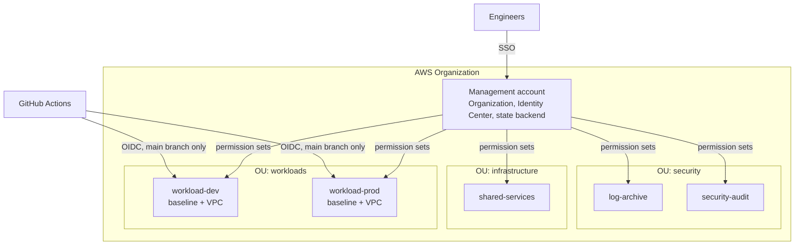

# AWS multi-account landing zone

[](https://github.com/pavangajjala/aws-landing-zone/actions/workflows/terraform.yml)

Terraform for a multi-account AWS setup: an organization with guardrails,
single sign-on through IAM Identity Center, a shared state backend, and a
baseline and network for each workload account.

It is based on the way I set up multi-account AWS for a startup, rebuilt here
as a clean reference with placeholder names and account IDs.

## Layout



| Path | What it does |
| --- | --- |
| `modules/organization` | Organization, OUs, member accounts, service control policies |
| `modules/identity-center` | Permission sets, groups and account assignments |
| `modules/state-backend` | Encrypted, versioned S3 bucket for state, locked with S3 lock files |
| `modules/account-baseline` | Password policy, S3 public access block, EBS encryption, Access Analyzer, GitHub OIDC deploy role |
| `modules/network` | VPC across three AZs, public and private subnets, NAT, flow logs |
| `live/management` | Root configuration for the management account |
| `live/workload` | One root configuration shared by every workload environment |
| `scripts/gen_backend.py` | Generates backend configs from `environments.yaml` |

## Design decisions

**One workload root, many environments.** `live/workload` is applied once per
environment with a different tfvars file and backend config. Dev and prod
cannot drift apart structurally because they are the same code.

**Backend configs are generated.** `environments.yaml` is the only place a
bucket or state key is written. The state key is derived from the environment
name, so two environments cannot share state by copy-paste accident. CI fails
if the generated files are out of date.

**Wrong-account protection.** The workload provider sets
`allowed_account_ids`. Applying prod variables with dev credentials fails
before a plan is produced.

**No long-lived keys.** People sign in through Identity Center. Pipelines
assume a role through GitHub OIDC, and the trust policy is pinned to the
`main` branch of named repositories.

**Guardrails above IAM.** Service control policies stop member accounts from
leaving the organization, disabling CloudTrail, Config or GuardDuty, using the
root user, or creating resources outside the allowed regions.

**Things that must not be deleted say so.** Accounts and the state bucket have
`prevent_destroy`, and the bucket keeps 90 days of old state versions.

More detail, including the access model and trade-offs, is in
[docs/architecture.md](docs/architecture.md).

## Usage

Requires Terraform 1.10 or newer, Python 3.9 or newer and credentials for the
organization's management account.

```bash
# 1. Edit environments.yaml and the defaults in live/management/variables.tf

# 2. Management account: organization, state bucket, SSO
make plan ENV=management
make apply ENV=management

# 3. Put the account IDs from the output into live/workload/envs/*.tfvars

# 4. Each workload environment
make plan ENV=dev
make apply ENV=dev
```

`make apply` only ever applies the plan file that `make plan` wrote, so what
was reviewed is what runs.

The first apply of `live/management` creates the state bucket, so it has to
start with local state. See
[docs/architecture.md](docs/architecture.md#bootstrapping) for the two-step
bootstrap.

## Checks

```bash
make fmt validate test
```

CI runs the same checks on every pull request: formatting, `terraform
validate` for each module and root, generator unit tests and the backend
drift check. None of them need AWS credentials.

## Status

The code passes `terraform validate` and its unit tests. Account names, email
domains, account IDs and repository names are placeholders, so review the
plan against your own organization before applying anything.

## License

MIT
